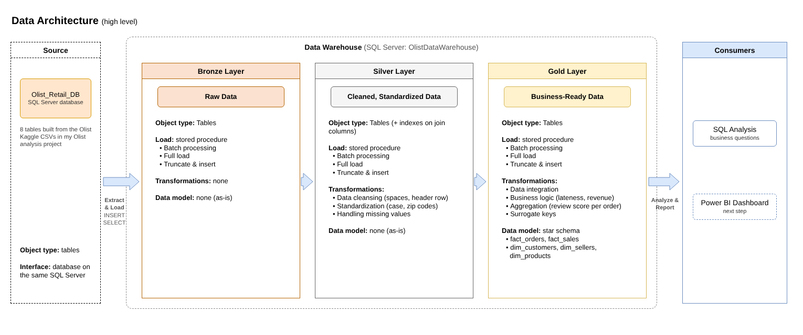
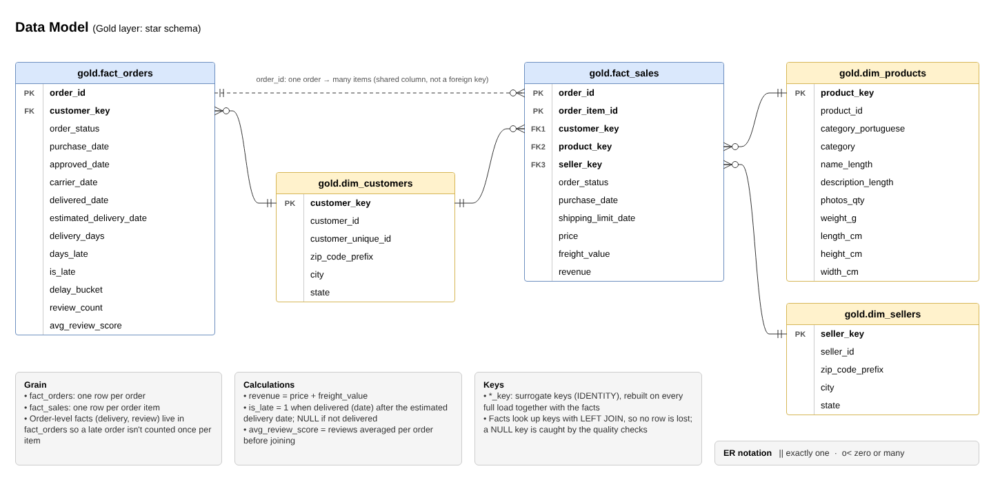

# SQL Data Warehouse: Olist E-Commerce

I built a data warehouse in SQL Server for Olist, a Brazilian e-commerce marketplace (about 100,000 orders from 2016 to 2018). It takes the raw order data, cleans it, and turns it into a star schema that answers the question from my analysis project: **how does delivery performance affect customer reviews?**

This project upgrades my [Olist e-commerce analysis](https://github.com/BachNguyen-111/olist-ecommerce-analysis). There, every query applied its own cleaning rules, and my dashboard once showed different numbers from my SQL. Here, the rules live in one place, and the warehouse gives **exactly the same numbers** as the original analysis (see [How I know the numbers are right](#how-i-know-the-numbers-are-right)).

SQL Server (T-SQL) · Medallion architecture · Star schema · Built with Claude as an AI assistant

---

## Architecture



The warehouse has three layers:

| Layer | What's in it | How it loads |
|---|---|---|
| **Bronze** | Raw data, exactly as it is in the source database | Truncate and insert (`bronze.load_bronze`) |
| **Silver** | Cleaned and standardized data, with indexes on the join columns | Truncate and insert (`silver.load_silver`) |
| **Gold** | Business-ready star schema with the business rules applied | Truncate and insert (`gold.load_gold`) |

The source is `Olist_Retail_DB`, the SQL Server database I built from the [Olist Kaggle dataset](https://www.kaggle.com/datasets/olistbr/brazilian-ecommerce) in my analysis project.

How each source table moves through the layers: [data flow](docs/data_flow.png)

---

## Data model



| Table | One row per | What it's for |
|---|---|---|
| **`fact_orders`** | Order | Delivery performance and reviews: delivery days, days late, `is_late`, delay bucket, average review score |
| **`fact_sales`** | Order item | Revenue by product, category, seller and time: price, freight, revenue |
| **`dim_customers`** | Customer ID | Customer location. `customer_unique_id` identifies the real person |
| **`dim_products`** | Product | Product size and weight, with the English category name |
| **`dim_sellers`** | Seller | Seller location |

Full column descriptions are in the [data catalog](docs/data_catalog.md).

---

## Data quality issues I handled

IDs refer to the [issue log](https://github.com/BachNguyen-111/olist-ecommerce-analysis/blob/main/docs/04_issue_log.md) of my analysis project.

| Issue | Where | What I did |
|---|---|---|
| A CSV header row had been loaded into the category table as data (DQ-14). I found it because the row count didn't match | Silver | Removed the row; Bronze still keeps it as-is |
| 610 products have no category (DQ-04) | Silver | Labeled them `uncategorized` |
| Text with inconsistent spacing and case, zip codes that could lose leading zeros | Silver | Trimmed, standardized case, padded zip codes to 5 digits |
| Olist creates a new `customer_id` for every order (DQ-07), so the repeat rate looked like 0% | Gold | Kept `customer_unique_id` in `dim_customers` for counting real customers |
| Some orders have several reviews (DQ-06), so joining them double-counts orders | Gold | Averaged the reviews per order before joining them to `fact_orders` |
| Orders that were never delivered have no delivery date (DQ-03) | Gold | Lateness is NULL for them, not "on time", so they can't inflate the on-time rate |

---

## Design decisions

- **Silver cleans, Gold applies business rules.** Silver fixes errors but keeps every order status and every review. Rules like "delivered orders only" or "average the reviews" are business choices, so they belong in Gold and in reports.
- **Two fact tables.** Delivery and reviews belong to the whole order, while revenue belongs to each item. Putting lateness in an item-level table would count a late order once for every item in it.
- **Gold started as views, then became tables.** With views, every query re-ran all the joins, and one of my quality checks never finished. I switched Gold to tables loaded once by a stored procedure and added indexes in Silver. The trade-off: Gold is only as fresh as the last load.
- **No slowly changing dimensions.** The Olist data is a fixed snapshot with no history of changes, so tracking versions (SCD Type 2) would add complexity without adding information.
- **`LEFT JOIN` when loading facts.** No sale is ever dropped. If a dimension row is missing, its key is NULL and a quality check catches it.
- **Full loads.** Each load empties the tables and reloads everything. It's simple and safe to rerun, and fast enough for about 100,000 orders.

---

## How I know the numbers are right

1. **Quality checks** for Silver and Gold ([`tests/`](tests)): no duplicate or missing keys, no rows lost or duplicated between layers, every fact row finds its dimensions.
2. **Reconciliation** with my analysis project, which calculated the same KPIs straight from the source database. Both give the same results:

| KPI | Analysis project | Warehouse (Gold) |
|---|---|---|
| Delivered orders | 96,478 | 96,478 |
| Revenue from delivered orders | R$15,419,773.75 | R$15,419,773.75 |
| Average review, on-time orders | 4.29 | 4.29 |

---

## How to run it

**You need:** SQL Server (Express works), SQL Server Management Studio (SSMS), and the `Olist_Retail_DB` database from the [analysis project](https://github.com/BachNguyen-111/olist-ecommerce-analysis) (built by its `sql/03_create_tables.sql`).

1. Run `scripts/init_database.sql` to create the `OlistDataWarehouse` database and its schemas.
2. Bronze: run `scripts/bronze/ddl_bronze.sql` and `scripts/bronze/proc_load_bronze.sql`, then `EXEC bronze.load_bronze;`
3. Silver: run `scripts/silver/ddl_silver.sql` and `scripts/silver/proc_load_silver.sql`, then `EXEC silver.load_silver;`
4. Gold: run `scripts/gold/ddl_gold.sql` and `scripts/gold/proc_load_gold.sql`, then `EXEC gold.load_gold;`
5. Check the results with `tests/quality_checks_silver.sql` and `tests/quality_checks_gold.sql`. Each check says what result to expect.

After the first setup, a reload is just three lines:

```sql
EXEC bronze.load_bronze;
EXEC silver.load_silver;
EXEC gold.load_gold;
```

---

## Repository structure

```
olist-data-warehouse/
├── docs/
│   ├── data_architecture.png   # the layers
│   ├── data_flow.png           # how each table moves through the layers
│   ├── data_model.png          # the star schema
│   ├── data_catalog.md         # every Gold column explained
│   └── naming_conventions.md
├── scripts/
│   ├── init_database.sql
│   ├── bronze/                 # raw load
│   ├── silver/                 # cleaning
│   └── gold/                   # star schema tables + load procedure
├── tests/
│   ├── quality_checks_silver.sql
│   └── quality_checks_gold.sql
└── README.md
```

---

## What I'd do next

- **Incremental loads:** only process new or changed orders, instead of reloading everything, for much larger data.
- **Scheduling:** run the three loads automatically every night with SQL Server Agent.
- **Connect Power BI to Gold:** so the dashboard from my analysis project uses the same cleaned data and business rules, from raw data all the way to the report.

---

## What I learned

- Why a warehouse is split into layers, and what belongs in each one (cleaning vs business rules)
- Designing a star schema: grain, facts vs dimensions, surrogate keys
- Why join order and join type matter (`LEFT JOIN`, matching grain before joining)
- How views and tables differ in performance, and why indexes matter
- Proving a pipeline is correct with quality checks and reconciliation

---

## Credits

- **Structure and naming conventions:** based on the [Data With Baraa](https://www.youtube.com/@datawithbaraa) SQL Data Warehouse tutorial. My first version of that project, on its CRM/ERP dataset, is [here](https://github.com/BachNguyen-111/data-warehouse).
- **Dataset:** [Brazilian E-Commerce Public Dataset by Olist](https://www.kaggle.com/datasets/olistbr/brazilian-ecommerce) (Kaggle).
- **AI assistance:** I used [Claude](https://claude.ai) (Anthropic) as an assistant to help write and review the SQL, write the documentation, and draw the diagrams. I made the design decisions above and tested every step.

## About me

I'm a business analytics student who enjoys the practical analytical side of data: figuring out how the numbers fit together and making them reliable enough to make decisions with.
